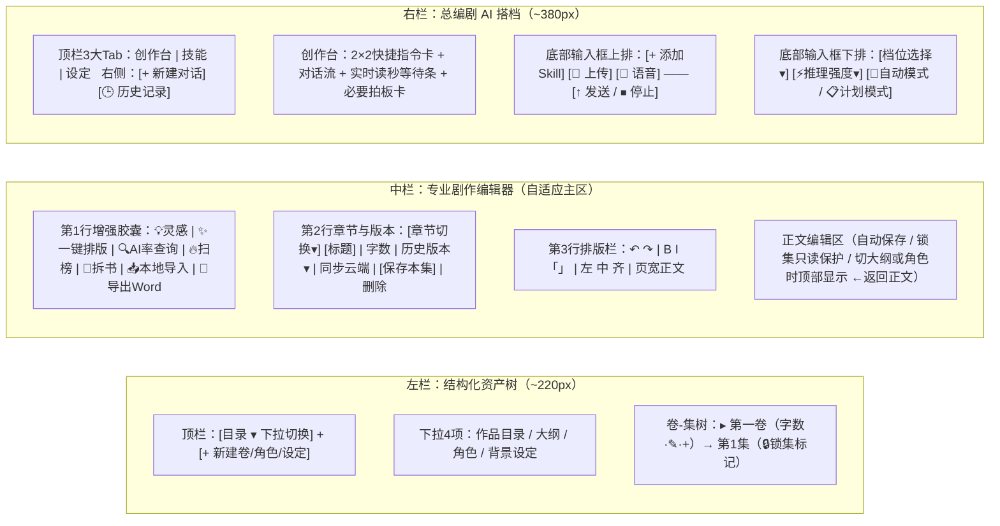

# 剧本工作台 3.0 深度融合规划方案（对标源炙创作台全交互拆解版）

> 本文档基于对 **源炙创作台（`writer.yuanzhi.icu`）** 登录页、书架大厅、用量仪表盘、三栏创作台及**全部按钮、下拉菜单、弹窗与右侧 AI 搭档控件**的逐项实测勘察，结合我们现有 **剧本工作台（总编剧 Story Studio）** 的六大 AI 工位中转调度、四大短剧流程、Skill 提示词插件系统与红线安全体系编写而成，可直接作为研发落地蓝图与验收清单。

---

## 一、产品总体架构与一级板块划分

仅取消源炙原站中的「墨笔行」与「游戏收益」板块，保留并重构订阅、充值、订单商业化闭环，形成完整的 **9 项一级导航板块**（左侧可折叠导航栏 + 顶部状态栏）：

| 左侧导航顺序 | 板块名称 | 路由 | 核心定位与页面形态 |
| :---: | :--- | :--- | :--- |
| 1 | **创作台** | `/studio`（首页默认） | **长篇/短剧创作大厅 + 三栏沉浸写作台**。承载 **国外迭代国外 / 国内迭代国外 / 原创** 三大核心写作流程。 |
| 2 | **拆书 · 扒剧** | `/breakdown` | **独立专属板块（替换原「墨笔行」）**。视觉与三栏布局格式与「创作台」高度统一，专门承载 **🎬 视频扒剧（直出真 `.docx` Word）** 与 **📖 拆书/拆原稿分析**，支持一键转入「创作台」开启改编迭代。 |
| 3 | **用量与额度** | `/usage` | 对标源炙「墨水情况」：展示可用额度、今日请求、今日消耗、累计 Token、平均耗时、近 7 天趋势图与实时调用记录表（直接对接现有 `auditLogs` 与账号 `budgetUsedUsd/budgetCapUsd`）。 |
| 4 | **我的订阅** | `/subscriptions` | 展示当前生效套餐、续订状态与历史订阅记录；支持随时取消订阅（仅停止后续自动续订，不回扣已入账的 `budgetCapUsd`）。 |
| 5 | **充值 / 会员** | `/purchase` | 展示管理员配置的套餐档位与额度包，支持创建购买/充值订单（支付渠道预留扩展槽，暂不接真钱第三方网关）。 |
| 6 | **我的订单** | `/orders` | 展示个人充值与套餐订单列表、支付/入账状态与对应额度明细。 |
| 7 | **兑换 / 邀请码** | `/redeem` | 创作者输入管理员分发的专属码或邀请码，一键激活账号或切换工作空间。 |
| 8 | **个人资料** | `/profile` | 账号昵称、密码修改、默认全局创作规矩管理、浅色（暖宣纸）/ 暗色主题偏好。 |
| 9 | **管理后台** | `/admin`（仅管理员可见） | **完整保留原有 6 大 Tab 并扩展商业化运营能力**：支持套餐价格与额度配置、管理员确认入账（含鉴权、归属、幂等防双充、金额额度正数校验与并发锁），以及原有中转调度、工位分配、Skill 插件、账号与档位管理。 |
### 全局顶部状态栏（全站统一）
- **左侧**：在书架大厅显示板块标题与副标题；进入某部剧后显示 **`← 返回剧架`** + **当前剧名**（点击可改名）。
- **右侧**：`🔔 公告通知` | `🌙 浅色/暗色模式切换` | `💧 剩余额度胶囊（如 $18.40 可用）` | `头像 + 用户名下拉菜单（切换账号 / 退出登录）`。

---

## 二、视觉设计系统：「暖纸墨韵 · 东方书房美学」

| 设计维度 | 规范细节 |
| :--- | :--- |
| **核心色板（浅色默认）** | 主背景 `#F9F6F0`（暖宣纸）、侧边栏 `#F4EFE6`、卡片底色 `#FFFFFF` / `#FAF7F2`、边框 `#E6DFD3`、主强调色 `#8C3B2B`（朱砂棕，用于主按钮与选中态）、辅助金 `#D49B54`（赭石金，用于新建作品与 ★ 推荐）。 |
| **字体与排版** | 展示级标题使用衬线/宋体（如 `我的剧架`、`用文字书写另一个世界`）；正文与操作按钮使用无衬线体；剧本编辑器支持「页宽正文」沉浸阅读排版。 |
| **登录页（`/login`）** | 复刻左图右卡水墨意境布局：左侧水墨山水/书桌意境 + 品牌主副标语；右侧圆角白卡，支持 Tab 切换 **「专属 Key / 邀请码登录」「账号密码登录」「邀请码注册」**（无缝衔接现有 `/api/auth`）。 |

---

## 三、板块 1 深度拆解：「创作台」（剧架大厅 + 三栏沉浸写作台）

### A. 第一层：我的剧架（`/studio` 大厅）
- **暖色 Hero 卡片**：左上角书本图标 + `My Bookshelf` + 衬线大标题 `我的剧架` + 副标题 + 双主按钮：**`+ 新建作品`**（赭金实心，弹窗选择 `国外迭代国外` / `国内迭代国外` / `原创` + 剧名 + 总集数/锁集范围）与 **`↓ 导入本地剧本`**（支持 `.docx/.txt/.md`）。
- **工具栏**：`我的作品 (N)` 计数标签 + `搜索作品名称...` 输入框 + 排序下拉（`最近更新` / `按名称`）+ 视图切换（`网格视图` / `列表视图`）。
- **作品卡片**：展示剧名、流程标签（如 `国外迭代 · 锁前10集`）、集数/总字数、更新时间、右键/更多菜单（`编辑信息` / `导出 Word` / `移入回收站` / `删除`）；末尾附虚线 `+ 新建作品` 快捷卡。

---

### B. 第二层：三栏沉浸式剧本工作台（点进作品后的全部按钮与下拉菜单）

#### 1. 左栏：结构化剧本资产树（核心交互：顶部「目录 ▾」下拉切换器）
左栏不平铺 4 个占空间的 Tab，而是采用 **顶部胶囊下拉 `[目录 ▾]` + 右侧动态新建按钮**：

| 下拉选项 | 右侧动态按钮 | 左侧展示结构 | 点击后中栏显示内容 |
| :--- | :--- | :--- | :--- |
| **作品目录** | `+ 新建卷` | 按「卷/季 → 分集」折叠树展示；每卷右侧带 **字数统计、`✎ 编辑卷名/删除卷`、`+ 新建分集`**；对锁定集显示 **🔒 锁定（一字不改）**。 | 正常显示该集剧本正文编辑器。 |
| **大纲** | `+ 新建大纲` | 三层大纲树：**`全剧总纲`** → **`分卷/每10集细纲`** → **`单集大纲（目标/冲突/结尾钩子）`**；同时自动承接流程中生成的「简化主线单」。 | 中栏切换为大纲编辑区，顶部出现 **`← 返回正文`** 按钮。 |
| **角色** | `+ 新建角色` | 角色卡片列表（含角色名、标准译名、定位标签）。 | 中栏编辑该角色的外貌、性格、关系网、声线与成长线。 |
| **背景设定** | `+ 新建设定` | 分层设定树：**`全剧设定`** / **`出海三道门（世界观·人设·替换要点）`** / **`地点·势力·道具设定`**。 | 中栏编辑对应设定文档，并自动注入 AI 上下文。 |

#### 2. 中栏：三行式工具区 + 沉浸式编辑器（逐按钮功能定义）
- **第 1 行：增强功能胶囊排（圆角暖杏底，点中亮朱砂红）**
  1. **`💡 灵感`**：弹出轻量弹窗，结合当前全剧大纲与已有集数，随机生成 1 条能立刻落笔的高能反转/冲突点子；底部带 **`换一个`** 与 **`一键插入正文`** 按钮。
  2. **`✨ 一键排版`**：一键将当前集正文规范为标准短剧排版（自动规整 `第X集 场次1-1 内/外景 地点 日/夜`、动作段前补 `▲`、统一人物台词冒号与中文引号「」），提示「已排版」。
  3. **`🔍 AI率查询`**：弹窗检测当前集正文（≥120 字），输出双可视化进度条：**`人工率 XX%`** vs **`疑似 AI 率 XX%`** + 不超过 60 字的判定依据（指出说教腔/翻译腔/AI 高频句式）+ **`重新检测`** 与 **`一键去AI味润色`**。
  4. **`🔥 扫榜`**：弹窗左侧提供平台列表（`抖音 / 微博 / 头条 / 百度 / B站 / 番茄小说 / 起点中文 / 七猫小说 / 晋江文学 / 飞卢小说`，并可扩展 **`红果短剧 / 海外短剧热榜`**），右侧实时展示热点榜单 + `刷新` / `换一批` + 一键将某条热点带入右栏聊脑洞。
  5. **`📖 拆书`**：快捷弹窗（输入来源名称 + 粘贴参考文本或上传 `.txt/.md/.docx` → 点击 `分析` 生成可执行文风/情绪曲线指南，并可一键保存到「本书规则」或跳转至独立的「拆书·扒剧」专区深拆）。
  6. **`📥 本地导入`**：导入本地 `.docx/.txt/.md/.srt` 直接切分/追加为当前作品章节或设定。
  7. **`📄 导出 Word`**：后端纯 Node 生成标准 OpenXML **真 `.docx` 文档**（按「故事梗概 → 人物小传 → 分集正文」自动排版，前 N 集锁定稿逐字保护）。

- **第 2 行：章节控制与版本栏**
  - `[章节切换 ▾]` 原生下拉框（快速跳转任意集） + 集标题输入框
  - `字数：XXX` 实时统计
  - **`历史版本`**（点击弹出浮层列表：按时间列出每次保存的快照与字数，点击任意一条一键恢复该版本）
  - **`同步云端`**（立即同步至服务端持久化存储，显示 `同步中…` / `已是最新`）
  - **`保存本集`**（朱砂实心主按钮，同时生成一条历史版本快照）
  - **`删除本集`**（二次确认弹窗，至少保留 1 集）

- **第 3 行：极简剧作排版栏**
  - `↶ 撤销 (Ctrl+Z)` | `↷ 重做 (Ctrl+Y)`
  - `B 加粗 (**)` | `I 斜体 (*)` | `「」加中文引号`
  - `左对齐` | `居中对齐` | `两端对齐` | **`页宽正文`**（点击切换固定页宽居中排版，模拟纸稿阅读感）

#### 3. 右栏：总编剧 AI 搭档（3 大 Tab + 底部双排全能控制栏）
- **顶部 3 大 Tab**（右侧附 `+ 新建对话`、`🕒 历史对话记录` 浮层）：
  - **Tab 1：`创作台`（主对话流）**
    - 空态展示 `✦ 你的创作搭档 · 下一段好故事，从这里开始` + **2×2 快捷指令卡**（点击直接执行对应模式）：
      1. `梳理全剧逻辑`（通读现有集数，找出前后矛盾，把事件线对上）
      2. `打磨这一集`（逐句看节奏、黄金前3秒冲突与集尾钩子，给出改写示例）
      3. `给本集挂卡写`（承接当前剧情、保住文风，直接向正文末尾追加续写）
      4. `一起找漏洞`（找出当前故事里的漏洞，给出 3 个能长出新情节的改法）
    - **沟通原则**：像正常员工向老板汇报一样简洁自然，去掉未开工时的废话建议框；等待时显示 **`⏳ 正在思考 / 起稿中 / 正在写入 · 已用时 X 秒`**；仅在需要老板拍板（如选主线、过三道门、确认集号冲突）时才弹出聚焦确认卡。
  - **Tab 2：`技能`（Skill 商店卡片流）**
    - 顶部 `搜索技能...` 实时筛选；下方展示管理员在 `/admin` 上传并启用的 `.md/.txt` Skill 插件卡片（图标 + 名称 + 两行简介 + 右侧 `启用 / 已启用` 按钮）。
    - **红线保障**：前台仅显示名称与简介，彻底隔离 `.md/.txt` 原始正文。
  - **Tab 3：`设定`（双层上下文规则）**
    - 顶部提示：`这里配置的规则会注入 AI 上下文：全局规矩对所有作品生效，本书规则只在当前作品生效。`
    - 卡片 1：**`全局规矩`（所有作品通用）** + 右上角 **`导入 txt / md`** 按钮（如：前 3 秒必出强冲突、杜绝说教腔、每集尾留钩子）。
    - 卡片 2：**`本剧规则`（仅当前作品生效）** + 右上角 **`导入 txt / md`** 按钮（如：主角译名固定、前 10 集锁定一字不动）。

- **底部输入框（2 排控件完整定义）**：
  - **上排**：`+ 添加 Skill`（快捷切换技能） | `📎 上传文件`（原稿/参考图/字幕） | `🎤 语音输入`（浏览器 Web Speech API，不支持时优雅提示） | 右侧 `↑ 发送`（生成中变为 `⏹ 停止`）。
  - **下排 3 个核心胶囊下拉**：
    1. **创作档位下拉**（对标源炙模型下拉，同时**严格守住不向前台暴露底层模型名的红线**）：管理员在 `/admin` 可把各工位路由映射为对创作者友好的档位名称与消耗提示（例如 `⚡ 极速档 · 消耗 0.5x`、`✨ 标准档 · 消耗 1x`、`👑 深度精修档 · 消耗 2x`），既保留源炙清晰的选档体验，又不泄露 `GPT/Gemini` 等内部模型名。
    2. **`⚡ 推理 ▾`（思考强度下拉）**：提供 **`关闭 / 低 / 中 / 高 / 超高 / 最高`** 选项（后端自动映射至对应模型的 reasoning/thinking 参数；若当前档位不支持思考则自动置灰提示）。
    3. **`📝 自动模式` / `📋 计划模式` 切换胶囊**：
       - **自动模式**：AI 拥有模块写入权限，生成的大纲、角色卡、背景设定、挂卡续写或整集正文会**自动写入左栏对应资产树与中栏编辑器**；右栏按真实 SSE/后台事件依次反馈「思考中 → 起稿中 → 正在写入 → 已写入完成」，并显示整数读秒（不是客户端假计时）。（增量六步第 2 步已落地）
       - **计划模式**：仅对话规划与讨论，AI **无写入权限**，绝不会误改你正在精修的正文。

---

## 四、板块 2 深度拆解：「拆书 · 扒剧」独立专区（`/breakdown`，替换原「墨笔行」）

严格按照你的要求：**不要「墨笔行」小游戏，单独做成「拆书 · 扒剧」专区，且整体视觉与三栏页面格式与总「创作台」保持高度一致**。

### 1. 专区大厅（同款「暖纸剧架」布局）
- 顶部暖色 Hero 区 + 双主按钮：
  - **`🎬 新建视频扒剧`**（直接拖入或选择 1 个或多个 `.mp4/.mov/.mkv/.srt`，不限视频大小）
  - **`📖 新建拆书 / 拆原稿`**（上传 `.docx/.txt/.md/.pdf` 或粘贴文本，深度拆解原稿五问、事件映射、情绪曲线与文风指南）
- 下方筛选栏：`全部` | `🎬 视频扒剧` | `📖 拆书分析` + 搜索框 + 网格/列表视图切换；每张卡片直接带 **`📄 下载 Word`** 与 **`🚀 转入创作台迭代`** 快捷按钮。

### 2. 点进任务后的同款三栏沉浸页面
- **左栏（顶部下拉切换：`素材与集号 ▾` / `人物锚定表` / `故事梗概` / `拆解维度`）**：
  - 扒剧任务：列出所有分集视频与自动识别的集号（`✓ 第 1 集`，点击可改），随时点击 `+ 添加视频` 补传；跑完后自动把「人物标准译名表」「故事梗概」结构化写入左栏对应下拉项。
  - 拆书任务：列出原稿章节、原稿五问、情绪曲线峰值、出海四级诊断节点。
- **中栏（成稿页宽预览 + 顶部一键交付栏）**：
  - 顶部动作条：**`📄 下载规范 Word (.docx)`**（朱砂主按钮）、`✨ 一键规范短剧排版`、`🚀 一键转入创作台（国外迭代 / 国内迭代）`、`历史版本`、`保存修改`。
  - 扒剧完成后，完整分场剧本（场景头、`▲` 动作、人物台词）直接排版展示在中栏，随时可微调或直接点下载 Word。
- **右栏（极简助手 · 正常员工汇报口吻，彻底告别复杂表单与刷屏）**：
  - **选模式极简卡**：只保留 **「⚡ 快速模式」** 与 **「🔍 详细模式」** 两张卡片和主按钮，**彻底移除「待拍板事项」和「补充或修改意见」两个多余文本框**。
  - **取消第 3 步空确认卡**：扒剧完成后，如无识别异常，**直接交付完成**，右栏气泡只用正常员工给老板汇报的口吻发一条简短消息（例如：「老板，《天降神運重生致富》第 1 集已按快速模式扒完，人物表、梗概和分场剧本都整理好了，右侧正文可直接看，点击下方就能下载 Word」+ **可点击下载的 `.docx` 文件卡片**），**绝不在聊天框里刷屏吐几千字 Markdown 原文**！
  - **发现问题才弹卡**：只有真正遇到模糊集号、画面看不清需人工确认、或角色名冲突时，才用汇报口吻说明具体问题并弹出对应确认卡。

### 3. 扒剧底层专项升级（放开视频大小 + 提速）
1. **放开视频大小限制**：
   - 上传接口升级为流式写入磁盘，移除 200 MB/28 MB 固定卡死限制；
   - 对常规单集短视频（≤30 MB）直接多模态直传 Gemini 看片；对超大视频自动采用服务端分段/关键帧抽帧或内嵌字幕轨提取策略，确保不因体积报错。
2. **输出全面提速**：
   - **Key-模型族亲和缓存**：`lib/server.ts` 记住每个 API Key 所属模型族（Gemini Key 直发 Gemini，GPT Key 直发 GPT），消除每次请求先撞错 Key 再重试的耗时；
   - **精简系统提示词冗余** + 强制 `tool_choice: 'none'` 防止中转站误调工具拖慢响应；
   - **多集并发扒剧 + 实时进度读秒**：多集上传时并发调度工位，并在界面实时显示「正在还原第 1/5 集 · 已用时 X 秒」。

---

## 五、现有代码资产复用与数据结构升级映射

所有改造均在现有 `Next.js 14` 代码库上平滑演进，**100% 复用已通过 49+ 项测试的后端底座**：

1. **`lib/types.ts`（向后兼容扩展）**：
   - `Project` 新增可选字段 `workspace`:
     - `volumes`: `Array<{ id, title, chapters: Array<{ id, title, episode?, locked?, content, wordCount, updatedAt, versions: Array<{ at, content }> }> }>`
     - `outlines`: `{ general: string, volumes: Record<string, string>, chapters: Record<string, string> }`
     - `characters`: `Array<{ id, name, alias?, role?, appearance?, personality?, arc? }>`
     - `settings`: `{ general: string, volumes: Record<string, string>, chapters: Record<string, string>, entries: Array<{ id, title, category, content }> }`
     - `projectRules`: `string`（本剧规则）
     - `chatMode`: `'auto' | 'plan'`（自动模式 / 计划模式）
     - `thinkingLevel`: `'off' | 'low' | 'medium' | 'high' | 'max'`
   - `StudioAccount` 新增可选字段 `globalRules?: string`（全局规矩）。
2. **`lib/server.ts`（复用 + 增强）**：
   - 保留 3 路中转池、六大工位路由、Skill 插件装配、多账号隔离、`sanitizeForClient` 红线脱敏；
   - 新增：`buildDocxBuffer(...)`（纯 Node 零重依赖生成标准 OpenXML `.docx` Word 文件）；Key-模型族亲和缓存；思考强度参数透传。
3. **新增 / 增强 API**：
   - `app/api/studio/route.ts`：新增 `save_workspace`、`save_chapter`、`restore_version`、`save_rules`、`run_tool`（`inspire` / `format` / `ai_rate` / `teardown` / `trending`）等操作；扒剧完成直接生成 `.docx` 下载链接并写入 `workspace`。
   - `app/api/upload/route.ts`：新增 `?export=docx` 返回真 `.docx`（`application/vnd.openxmlformats-officedocument.wordprocessingml.document`），并升级大视频流式接收。
   - `app/api/usage/route.ts`（新增）：聚合当前账号的 `auditLogs` 与额度消耗，驱动 `/usage` 页面的 KPI 卡片、7 日趋势图与明细导出。

---

## 六、分阶段实施与验收计划

- **阶段 1（P0 · 暖纸视觉壳 + 剧架大厅 + 「拆书·扒剧」专区 & 真 Word 直出提速 — 已完成）**：
  - 落地暖纸墨韵设计系统、左图右卡 `/login`、基础导航栏、`创作台` 剧架大厅与 **`拆书·扒剧`（`/breakdown`）独立专区**。
  - 落地真 `.docx` Word 导出、扒剧极简化（去多余文本框与第 3 步空卡、员工汇报口吻）、放开视频大小限制与连接亲和提速。
- **阶段 2（P0 · 三栏沉浸式创作工作台全功能落地 — 已完成）**：
  - 落地左栏「目录 ▾」4 项下拉资产树（作品目录+锁集保护 / 三层大纲 / 角色卡 / 背景设定）、中栏三行式专业编辑器（含历史版本回滚与页宽排版）、右栏 3 大 Tab（`创作台` 2×2 快捷指令 + `技能` 卡片流 + `设定` 全局/本剧规则）及底部 `档位 / 推理强度 / 自动与计划模式` 全套控件。
- **阶段 3（P1 · 增强工具弹窗全套 + `/usage` 用量概览仪表盘 — 已完成）**：
  - 落地 `灵感`、`一键排版`、`AI率查询（人工率/疑似AI率双条）`、`扫榜（10+平台）`、`拆书分析` 与 `/usage` 仪表盘（KPI + 7 日趋势 + 明细导出）。
- **商业化扩展 · 第 1 步（基础架构与人工确认闭环 — 已实现，第 2–6 步未开始）**：
  - **已实现内容**：
    1. 左侧导航扩展为 9 项（`创作台 /studio`、`拆书·扒剧 /breakdown`、`用量与额度 /usage`、`我的订阅 /subscriptions`、`充值 / 会员 /purchase`、`我的订单 /orders`、`兑换 / 邀请码 /redeem`、`个人资料 /profile`、管理员专属 `管理后台 /admin`），仅禁止「墨笔行」与「游戏收益」。
    2. Store 兼容迁移新增 `plans`、`subscriptions`、`orders` 结构，完整保留既有账号与额度配置。
    3. 落地 `/subscriptions`、`/purchase`、`/orders` 三页与对应 API，取消订阅仅停止续订、不回扣已入账 `budgetCapUsd`。
    4. 管理后台保留原 6 个 Tab，新增套餐价格额度管理与管理员确认入账（含鉴权、归属、幂等防双充、金额额度正数校验、并发锁），支付渠道仅保留扩展槽位不接真钱网关。
    5. 保留原有 4 套 `npm test`，新增隔离夹具测试 `tests/commerce-migration.mjs` 并更新 `tests/v3-e2e.mjs`（`T1-01` 校验 9 项导航、仅禁墨笔行与游戏收益并覆盖三路由/API）。
  - **未开始内容**：商业化第 2–6 步（后续自动续订调度、真实支付渠道对接、财务对账及进阶营销体系等）尚未开始；浏览器端多视口真实渲染验收尚未执行。
  - **本步验收命令**：`npm test && node tests/commerce-migration.mjs && node tests/v3-e2e.mjs && npm run build`（以实际执行结果为准）。

- **3.0 工作台增量六步（与上方商业化扩展步骤相互独立）**：
  - 第 1 步已交付 `main` `0efc3811b85ca6ad2030f3cd24bb5b7a970f127b`。
  - **第 2 步（已完成，尚未开始第 3 步）**：`director_generate` / `director_cancel` + SSE 阶段回传；自动模式 5 类写回左树与中编辑器；计划模式服务端只读；前 N 集锁定在全部写回/续写路径逐字不变；失败/取消不写半截产物；客户端脱敏。验收：`node tests/step2-writeback-lock.mjs`、`STUDIO_LLM_FIXTURE=1` 浏览器验收（3199），以及原 4 套 `npm test`、`commerce-migration`、`v3-e2e`、`npm run build`。跑真实应用前后须备份并恢复 `.data/studio-store.json` 与 buckets。
